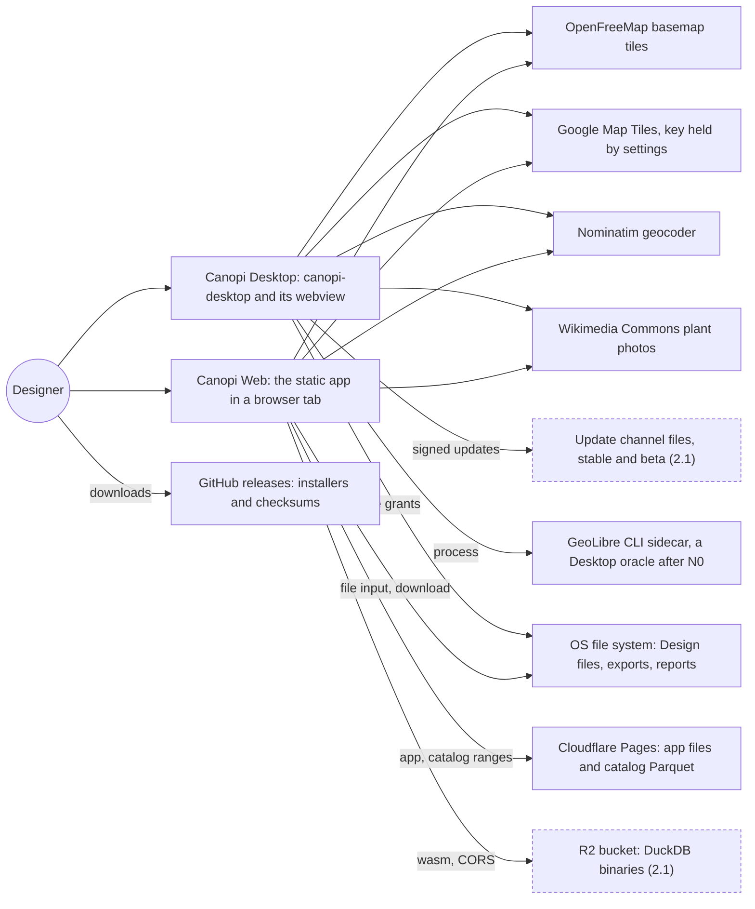
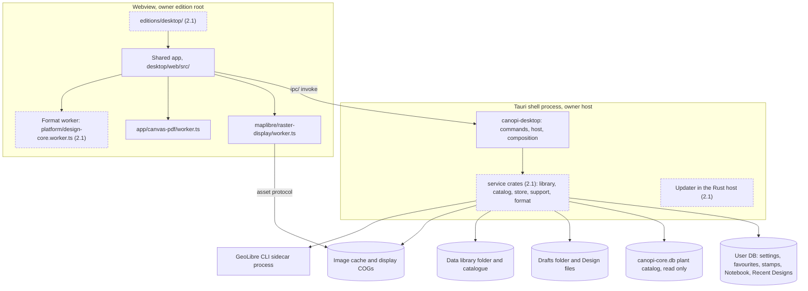
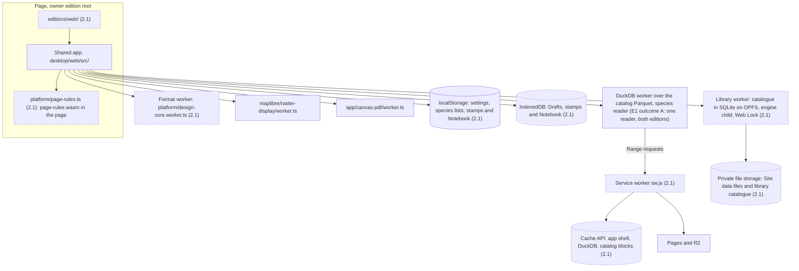
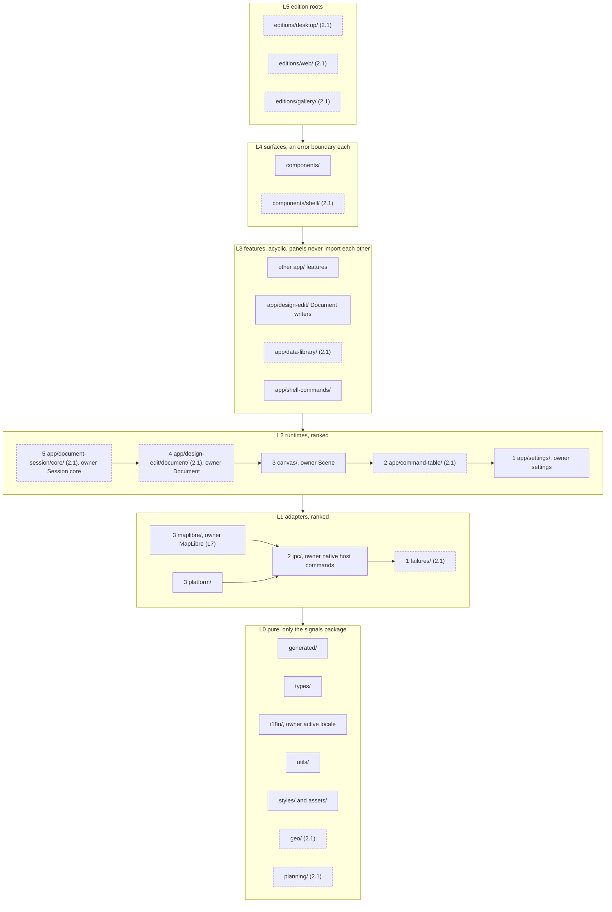
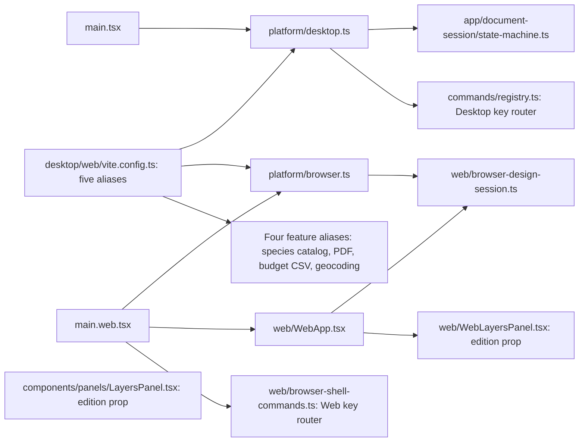
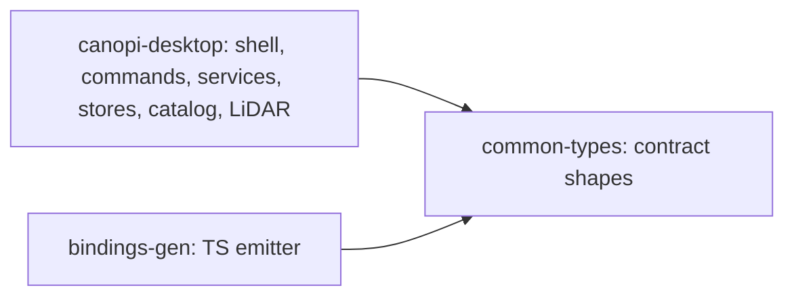
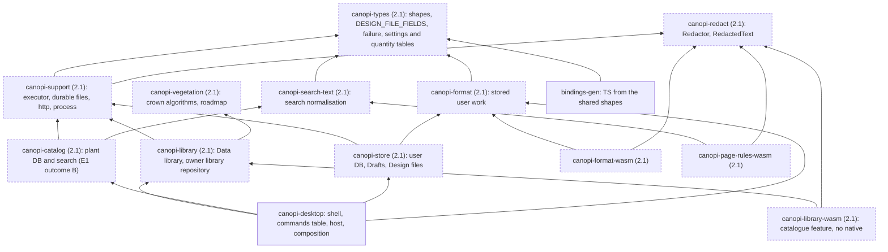
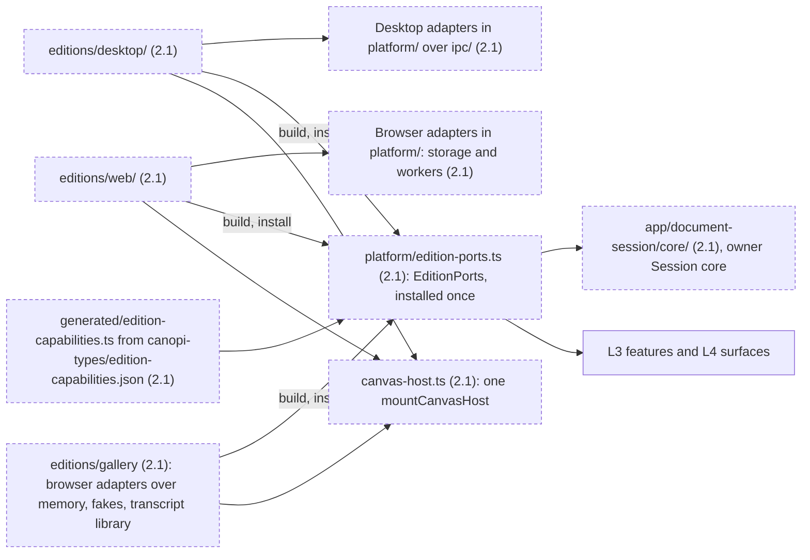

# Components

What Canopi is made of at C4 levels 1 to 3, and which way each part may depend. The rules are in ADRs 0005, 0022, 0023, 0024, 0029 and 0030; the ADR wins on conflict.

## Level 1: system context

### System context

Model: target
Source: ADR 0005, ADR 0029, ADR 0030, 2.1-M8, 2.1-M91

- No backend (2.1-Q71): every external system is a static host or a public service, and a problem report is a zip the user saves and sends; nothing leaves without a user action (2.1-Q74).
- The Google key and the location reading never reach a Design, export, report or log (`map-error-redaction.test.ts`, `problem-report-diagnostics.test.ts`, `my-location-trust.test.ts`).
- Both editions reach the same services; any difference is a row of the edition-capabilities table (ADR 0030, `edition-root-parity`, Phase 2a).

## Level 2: containers

### Desktop containers

Model: target
Source: ADR 0022, ADR 0023, ADR 0029 Release safety

- `canopi-desktop` is the only crate with Tauri, and `ipc/` the only frontend caller of `invoke` (cargo-deny, dependency-cruiser `tauri-only-in-native-host` and `ipc-only-in-desktop-adapters`, ast-grep `invoke-only-in-ipc`).
- Every published file goes through `publish_durably` in `canopi-support` (2.1), behind the `DurableFs` fault seam (ADR 0023).
- The updater runs in the host; the webview holds no `updater:*` permission (2.1-M54).

### Web containers

Model: target
Source: ADR 0022 Canopi Rust on Web, ADR 0029 Static Web serving, contracts §11

- Decoders of untrusted input (`canopi-format-wasm` (2.1), the library readers) run in workers; only the page rules run in the page (2.1-M48).
- One wasm adapter per `-wasm` crate, the only importer of its glue (`wasm-glue-only-in-adapter`, created with each crate). No cross-origin isolation, so wasm is single-threaded.
- DuckDB runs from a same-origin worker URL so its requests pass the service worker (2.1-M45); at HEAD its bundles still come from jsDelivr, deleted by W1.

## Level 3: components

### Frontend layers

Model: target
Source: ADR 0022 Layers, 2.1-Q1, 2.1-M20

- A layer imports only layers below; inside L1 and L2 a directory imports only lower ranks, and equal ranks import none of each other. One owner: `policy/layers.json`, which generates the dependency-cruiser `layer-order` and `edition-roots` rules.
- `maplibre/` imports nothing from `canvas/`; it hosts a scene through `maplibre/scene-host-layer.ts` (2.1). `app/command-table/` (2.1) imports no feature.
- Every top-level path has one layer or a named destination in `policy/layers.json`; `target/` is L3: it imports `canvas/` (L2), and its importers in `canvas/` and `maplibre/` are `layer-order` entries (finding COMP-F01, 2.1-M244).

### Edition selection at HEAD

Model: current
Source: ADR 0022 Context; replaced by the edition roots in Phase 2a

- Three edition mechanisms (aliases, `web/` composition, edition props), two Session controllers and two command catalogs; Phase 2a deletes them, and this diagram goes in that change.

### Rust crates at HEAD

Model: current
Graph: cargo

- One crate holds the shell and every service; the split below replaces it from Phase 1a to Phase 3 N2.

### Rust crates

Model: target
Source: ADR 0023, 2.1-Q9, 2.1-Q34, 2.1-Q122, 2.1-M4

- No edge between `canopi-catalog` (2.1) and `canopi-store` (2.1); only `canopi-desktop` depends on both and composes favourites with the catalog.
- Tauri only in `canopi-desktop`; tauri, tokio and sqlite never under `canopi-format` (2.1); wasm-bindgen only in the `-wasm` crates (cargo-deny, Phase 0). Rust SCC count 0 (`rust-scc` ratchet).
- Inside `canopi-library` (2.1): leaves < engines < repository < extensions < jobs < facade, and no extension imports another (`module_layering.rs`, narrowed by N1).

### Ports and edition roots

Model: target
Source: ADR 0022 Ports, ADR 0024, ADR 0030, contracts §4, §13, §16

| Port | Declared in | Desktop adapter | Web adapter | Protects |
|---|---|---|---|---|
| DesignHomeStore | `platform/design-home.ts` (2.1) | native files, file grants | IndexedDB Draft store, file input, download | L10, L17, L21 |
| DesignCore | `platform/design-core.ts` (2.1) | format worker, bytes through `ipc/bytes.ts` (2.1) | format worker over `canopi-format-wasm` (2.1) | L5 |
| FileDelivery | `platform/file-delivery.ts` (2.1) | dialog and native write | download | L12 |
| File access | `platform/file-access.ts` (2.1) | host dialogs with `pickOpen`, `pickHomeTarget`, `convertFileSrc` | file input | L9 |
| App lifecycle | not named | close and exit requests, update install | visibility, page hide and show, version change | ADR 0024 |
| Settings store | `platform/settings.ts` (2.1) | user DB settings row | localStorage record | L16 |
| Data library | `platform/library.ts` (2.1) | library commands (N3) | library worker over SQLite on OPFS (N5) | L21 |
| Species reader | not named | native catalog commands | DuckDB reader | L20, while two remain (2.1-E1) |
| Saved stamps, Design Notebook | not named | user DB | browser record | L21 |
| Scene host layer | `maplibre/scene-host-layer.ts` (2.1) | the Pixi layer on both | the same | L8; the caller hands the factory |

- Only the roots build and install `EditionPorts` (2.1); feature code reads a capability from its set, never the edition (`edition-ports-installed-only-by-roots`, `no-edition-check`). Fields and their files: contracts §22.
- Every port's contract suite runs against both editions' adapters (ADR 0028, contracts §13).
- One implementation, no port: MapPorts as `Pick<maplibregl.Map>`, the Pixi kit, the geocoder in `app/geocoding/`, Desktop window control and the clipboard adapter; a Session question is core state, never a callback a root binds (2.1-M162).
