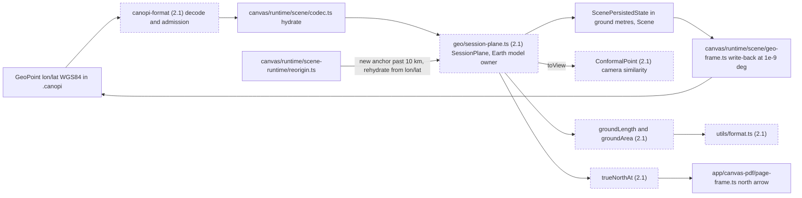
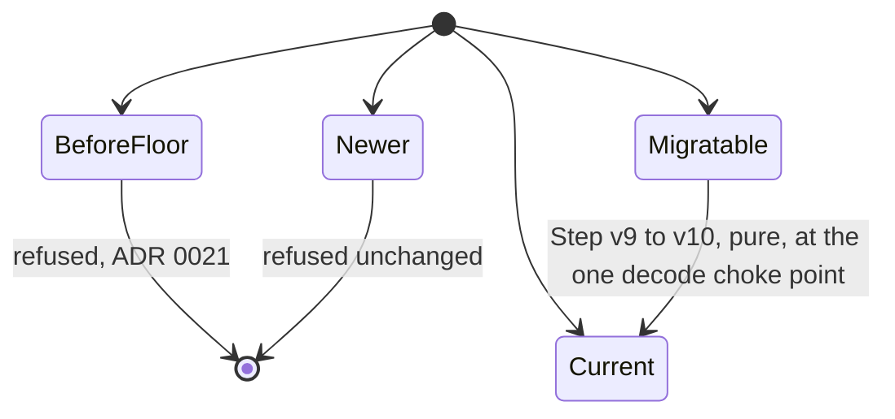
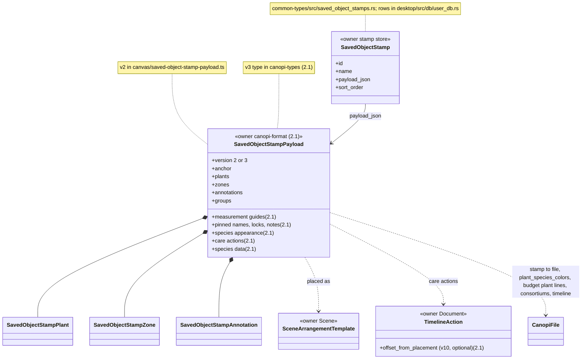

# Design data structures

Answers what a Design holds, who writes each part and where it persists: the fields, coordinates, the `.canopi` v10 shape, saved-stamp payloads and print setups. Rules: ADR 0001, 0007, 0008, 0024 and 0026, contracts §4, §10, §11 and §20; the ADR wins on conflict.

### Design fields and their authorities

Model: target
Source: ADR 0022 L5, ADR 0024, contracts §4 and §10, 2.1-Q69, 2.1-M90, 2.1-M94

```mermaid
classDiagram
  class DesignFileField {
    <<owner canopi-types (2.1)>>
    +key
    +owner
  }
  class DesignFileFieldOwner {
    <<enumeration>>
    Scene
    Document
    Format (2.1)
  }
  class CanopiFile {
    <<owner canopi-format (2.1)>>
    +version Format
    +updated_at Format
    +map_view Format
    +plant_species_colors Scene
    +plant_species_symbols Scene
    +plant_species_codes Scene
    +layers Scene
    +plants Scene
    +zones Scene
    +annotations Scene
    +measurement_guides Scene
    +groups Scene
    +name Document
    +description Document
    +created_at Document
    +consortiums Document
    +timeline Document
    +budget Document
    +budget_currency Document
    +lidar Document
    +views Document
    +stories Document
    +extra Document
    +plant_display Document (2.1)
    +print_setup Document (2.1)
  }
  class FormatFields {
    <<2.1>>
    <<owner Format>>
    +version
    +updated_at
    +map_view
  }
  class ObjectGroup {
    <<owner Scene>>
    +members: ObjectId[] (no position)
  }
  class SceneFields {
    <<2.1>>
    <<owner Scene>>
  }
  class DocumentFields {
    <<2.1>>
    <<owner Document>>
  }
  class ScenePersistedState {
    <<owner Scene>>
    +plane metres
  }
  DesignFileField --> DesignFileFieldOwner
  CanopiFile ..> DesignFileField : one row per key
  FormatFields ..> CanopiFile : encoder writes
  CanopiFile *-- ObjectGroup : groups
  SceneFields ..> CanopiFile : Pick of Scene keys
  DocumentFields ..> CanopiFile : Pick of Document keys
  ScenePersistedState ..> SceneFields : serialised to
  note for DesignFileField "common-types/src/design.rs DESIGN_FILE_FIELDS"
  note for SceneFields "types/design-fields.ts (2.1), generated by bindings-gen"
  classDef target stroke-dasharray: 4 3
  class FormatFields:::target
  class SceneFields:::target
  class DocumentFields:::target
```

- Owner: `DESIGN_FILE_FIELDS` gives each key one writer: Scene through the scene runtime's transactions (`canvas/runtime/scene-runtime/transactions.ts`), Document through Design Edit (`app/design-edit/`), Format keys by the encoder (2.1). A new field is one row plus `canopi-format` (L5).
- Invariant: the Scene serializer is typed `Pick<CanopiFile, SceneKey>` and cannot write a Document key; only the serializer and the generated defaults factory build a whole `CanopiFile` (ast-grep `no-canopifile-literal`, 2.1). Unresolved references from Document data to Scene objects or library ids are kept and shown unavailable; groups normalise; a last plant's consortium entry is pruned (contracts §10).
- Tests: `document-format-contract.test.ts` and `design-edit-authority-only-in-core`; in the target `canopi_format_fixture_covers_every_field`.

| Type | Owner | Persistence home |
|---|---|---|
| `CanopiFile` | `canopi-format` (2.1; today `desktop/src/design/format.rs`), fields as above | `.canopi` file, Desktop Draft file, Web Draft record, stamp file |
| `GeoPoint` | value type | every stored position, WGS84 degrees |
| `Layer`, `PlacedPlant`, `Zone`, `Annotation`, `MeasurementGuide`, `ObjectGroup`, `ObjectGroupMember` | Scene | `.canopi` |
| version, updated_at, map_view | Format | the encoder and the core |
| `Consortium` (only user-edited rows; the rest derived), `TimelineAction`, `BudgetItem`, `SavedView`, `Story`, `LidarPresentationSection` | Document (Design Edit) | `.canopi` |
| `ScenePersistedState`, `SceneStore` | Scene | memory, plane metres |
| `SessionPlane` | the Earth model | memory; its anchor is never stored |
| `SavedObjectStamp`, `SavedObjectStampPayload` | stamp store; chain in `canopi-format` | Desktop user DB `saved_object_stamps`; Web browser record |
| `PrintSetup`, `PlanePrintSetup` | Document; `PlanePrintSetup` derived by `app/canvas-pdf/print-setup.ts` (2.1) | `.canopi` `print_setup`; the plane form never stored |

### Coordinates: file, plane and view

Model: target
Source: ADR 0001, ADR 0016, contracts §20, 2.1-Q78d, 2.1-M91



- Owner: `geo/session-plane.ts` (2.1), today `canvas/session-plane.ts`, is the one Earth model. A plane metre is a WGS84 ground metre at the anchor (Web Mercator scaled by N cosφ east and M north), x east, y south, north-aligned at any bearing; the radii come from `canopi-types`.
- Invariant: stored lon/lat is the only authority. The anchor is the objects' bounds centre or the view centre and is never stored; re-origin builds a new plane and re-hydrates; write-back rounds to 1e-9 degrees idempotently. Every shown length and area is `groundLength` or `groundArea`.
- Tests: `geolocated-design-codec.test.ts`; in the target `scale-only-through-plane`, the 1e-6 px landing and the 1 ppm Vincenty checks of contracts §20.

### The .canopi file: v9 and v10

Model: target
Enum: Admission (2.1)
Source: ADR 0026, contracts §10, 2.1-Q35r, 2.1-Q69, 2.1-Q96, 2.1-Q162



| Aspect | v9 (`CURRENT_CANOPI_FILE_VERSION = 9`) | v10 (2.1) | Owner |
|---|---|---|---|
| Ramps, raster quantities, locales | closed literal sets | open strings: an unknown literal is kept, its default used | `canopi-format` |
| Unknown keys | root only, through the flattened `extra` | an extension bag on every nested object | `canopi-format` |
| Plant display | `extra.plant_display` through `app/design-edit/extra-keys.ts` | typed field `plant_display`; the extra-key registry deleted if empty | Document |
| Budget | `BudgetItem` lines with category, quantity and currency each | plant lines only (target, unit cost), one currency; non-plant lines kept unshown in the budget's bag | Document |
| Group members | plant, zone, annotation | adds measurement guide; normalised at decode, refused on write | Scene |
| Additions, no step (`canopi-format/spec/v10/additions/` (2.1)) | none | `print_setup` (Document); zone stroke colour and opacity (Scene) | spec emitter |
| Codec | native `desktop/src/design/format.rs`; TS `app/contracts/canopi-design-schema-decoder.ts` | `canopi-format-wasm` (2.1) in the format worker on both editions, canonical encode; TS decoder deleted | `canopi-format` |

- Owner: `canopi-format` (2.1) owns read checks, the chain (`FLOOR = 9`, `CURRENT = FLOOR + STEPS.len()`), write admission, the new-Design builder and the frozen spec per version.
- Invariant: a migrated open is clean; the first Desktop write in v10 keeps `<name> (Canopi 2.0).canopi` once; a migrated Desktop Draft keeps its v9 form once, unlisted; a failing step refuses with `migration_failed{from}`.
- Tests (2.1): `migration_steps_frozen`, the chain from every fixture to head, the encode-decode property test.

### Saved stamp payload v3

Model: target
Source: ADR 0007, ADR 0026 Saved stamps, contracts §11, 2.1-Q155, 2.1-M88, 2.1-M89



- Owner: each edition's stamp store owns the rows and the library order (new rows take max + 1); `canopi-format` (2.1) runs the payload chain from floor 2 per row at open, in the format worker on both editions.
- Invariant: positions are relative ground metres from the anchor, never `.canopi` objects. A payload newer than known lists as needing a newer Canopi and is never placed, written or deleted. A placement is one `core.compound` (2.1) entry: objects and species appearance through a Scene transaction, care actions and species data through Design Edit, species data filling only where the Design has none.
- An exported stamp is a `.canopi` from the core builder and per-entity serializers (`app/saved-object-stamps/file.ts` today); tests: `saved-object-stamp-file.test.ts`, plan 2c's "a stamp with guides, locks, notes and a care action places them all", and a v3 payload with every Q155 item round-trips through the real codec (2b).

### Print setup

Model: target
Source: ADR 0008, contracts §10, 2.1-Q151, 2.1-Q152, 2.1-M90, 2.1-M91, 2.1-M160, 2.1-M161

```mermaid
classDiagram
  class PrintSetup {
    <<2.1>>
    <<owner Document>>
    +pages in print order
    +splits
    +paper and print options
  }
  class PrintPage {
    <<2.1>>
    +id, name, framing
    +area Box, WholeDesign or SplitSheet
  }
  class SplitSheet {
    <<2.1>>
    +split
    +along_page right_m, down_m
    +size at the pivot's scale
  }
  class PrintSplit {
    <<2.1>>
    +pivot
    +angle_deg clockwise from true north
  }
  class PlanePrintSetup {
    <<2.1>>
    <<derived, never stored>>
  }
  CanopiFile --> PrintSetup : print_setup
  PrintSetup *-- PrintPage : pages
  PrintSetup *-- PrintSplit : splits
  PrintPage ..> SplitSheet : area
  SplitSheet ..> PrintSplit : split
  PrintSetup ..> PlanePrintSetup : inPlane(setup, plane)
  classDef target stroke-dasharray: 4 3
  class PrintSetup:::target
  class PrintPage:::target
  class PrintSplit:::target
  class SplitSheet:::target
  class PlanePrintSetup:::target
```

- Owner: Design Edit writes `print_setup` through `core.document()` (2.1); a workspace session writes under one coalesce key that any other entry seals (2.1-M160), and exporting never changes the Design. `PdfSetup`, `PdfPrintArea`, `PdfPageView` and `PdfMapOrientation` give way to `PrintSetup` and each page's angle (North up, As on screen, a saved view's bearing, Turn to edge, typed).
- Invariant: stored areas are WGS84 centres with ground sizes along the page axes; only `print-setup.ts` crosses frames (`inPlane`, `applyPrintEdit`); a split's sheets use the pivot's scale, so they tile at any latitude (2.1-M161). One page frame (`app/canvas-pdf/page-frame.ts`) turns the snapshot by the page's angle; each north arrow reads `trueNorthAt`.
- Persistence: a v10 addition with no step, ignored by the reader release, which opens such a file read-only. Tests: `canvas-pdf-workflow.test.ts`, `page-frame.test.ts`.
