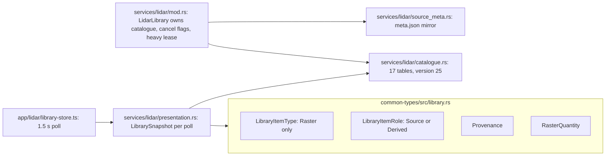
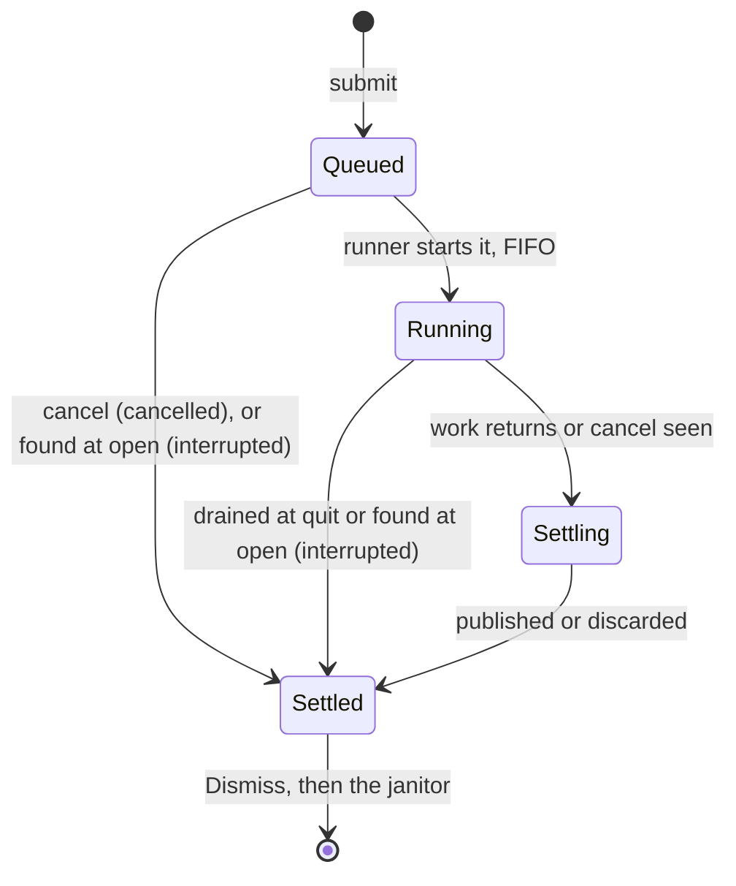
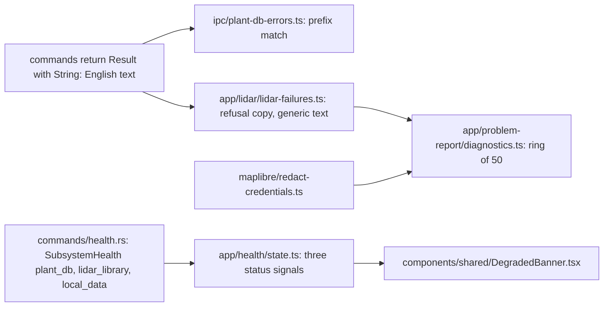
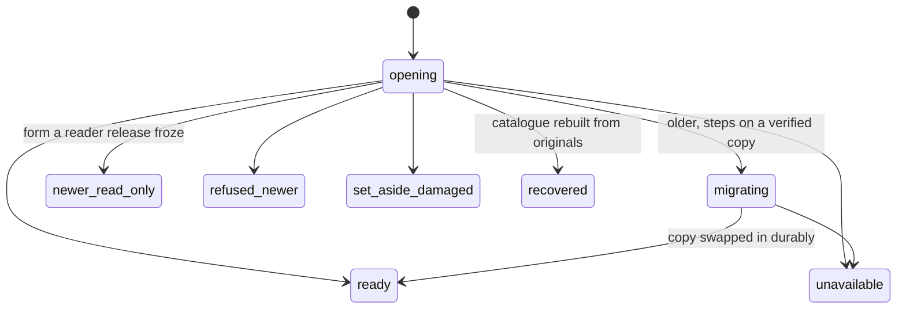

# Data services

The data that lives outside the Design: Data library items and analyses, jobs, settings, capabilities and failures, with the owner of each. The rules are in ADRs 0023 to 0027 and 0030 and the foundations contracts §2, §3, §7, §8, §11 and §21; the ADR wins on conflict.

### Library items, kinds and lineage

Model: target
Source: ADR 0023, ADR 0027; contracts §7, §9; 2.1-M46, 2.1-Q100

```mermaid
classDiagram
  class LibraryItemKind {
    <<2.1>>
    <<owner canopi-types (2.1)>>
    Raster
    Vector
    literal()
    ALL
  }
  class ItemRow {
    <<2.1>>
    <<owner library repository>>
  }
  class Item {
    <<2.1>>
    <<owner library repository>>
    decode(ItemRow) Result
    claims() LibraryPath list
  }
  class Lineage {
    <<2.1>>
    <<owner library repository>>
    Source
    Analysis(provenance)
    External(tool, date, notes, links)
  }
  class Provenance {
    <<owner library repository>>
  }
  class DisplayRecipe {
    <<2.1>>
    <<owner analysis registry row>>
    scale
    output quantity
    sentinels
  }
  class LibraryItemId {
    <<2.1>>
    <<owner library repository>>
  }
  class LibraryItemSummary {
    <<owner library facade>>
  }
  ItemRow ..> Item : decode, the only reader of kind
  Item --> LibraryItemId
  Item --> LibraryItemKind
  Item --> Lineage
  Lineage --> Provenance
  Item ..> DisplayRecipe : prepare_display
  Item ..> LibraryItemSummary : no raster-only field
  note for LibraryItemId "library_items: id, kind, lineage_tag, name_key UNIQUE; a Site data entry holds only the id"
  classDef target stroke-dasharray: 4 3
  cssClass "LibraryItemKind,ItemRow,Item,Lineage,DisplayRecipe,LibraryItemId" target
```

- Owner: the `canopi-library (2.1)` repository holds all library SQL, the kind decode, item names (one UNIQUE key, one allocator) and claims; `kinds.rs` holds every exhaustive match over the kind; the janitor alone deletes library files.
- Invariant: an unknown stored kind literal is refused, never read as a raster; catalogue CHECKs are generated from `ALL` (catalogue 25 to 26).
- Tests: CHECK equals enum `ALL`; the janitor sweep property test; `no-lineage-field-read`.

### Library items at HEAD (replaced by kind and lineage)

Model: current



- At HEAD the role means three things (storage table, `.canopi` entry kind, is a result), and `'raster'` is a SQL literal in several sites.

### Analysis registry and the quantity table

Model: target
Source: ADR 0027; contracts §7, §14; 2.1-M44

```mermaid
flowchart LR
  JSON[common-types/analysis-registry.json: rows with output quantity, sentinels, presets]
  GEN[bindings-gen/src/analysis_registry.rs]
  RS[services/lidar/analysis_registry_generated.rs]
  TS[generated/analysis-registry.ts]
  EXE[services/lidar/analyses/terrain.rs: slope]
  EXT[canopi-library analyses, one module per analysis (2.1)]:::target
  EXR["executor(id) -> AnalysisExecutor over ENGINES (2.1)"]:::target
  QT[canopi-types quantity table (2.1)]:::target
  DESC[app/data-library/ item-type descriptor and lineage table (2.1)]:::target
  IT[app/lidar/item-types.ts: TS-only facts]
  LAY[maplibre/library-layers.ts (2.1)]:::target
  JSON --> GEN
  GEN --> RS
  GEN --> TS
  RS --> EXE
  RS --> EXR
  EXR --> EXT
  QT --> DESC
  TS --> DESC
  DESC --> IT
  DESC --> LAY
  classDef target stroke-dasharray: 4 3
```

- Owner: a row names its output quantity and display recipe; the quantity table owns unit family, display scale and range; analysis rows never say how they run. `RASTER_QUANTITIES` is deleted.
- Invariant: panels read only the descriptor, never `lineage` or `provenance.analysis_id`; unit formatting dispatches on quantity, not unit strings.
- Tests: `every_output_quantity_has_a_row`, `analysis_row_has_golden_fixture`, `unit-maths-only-in-quantity-owner`.

### Native scheduling types

Model: target
Source: ADR 0025; contracts §1, §3

```mermaid
classDiagram
  class OpSpec {
    <<2.1>>
    <<owner canopi-support (2.1)>>
    lane
    priority
    deadline
  }
  class Deadline {
    <<2.1>>
    <<owner canopi-support (2.1)>>
    value or Unbounded
  }
  class CancelToken {
    <<2.1>>
    <<owner canopi-support executor (2.1)>>
    reason User, Superseded or Shutdown
    supersede_key
    drop guard
  }
  class OperationId {
    <<2.1>>
    <<owner canopi-types (2.1)>>
    origin user or system
  }
  class JobId {
    <<2.1>>
    <<owner jobs runner>>
  }
  class Slot {
    <<2.1>>
    <<owner jobs runner>>
    Heavy
    Display
  }
  class NativeOperationClass {
    <<owner native_operation.rs>>
    Catalog
    UserData
    Local
    Network
    Raster
  }
  OpSpec --> Deadline
  OpSpec ..> CancelToken : run(op, token, work)
  JobId ..> OperationId : library_jobs.operation_id
  OpSpec ..> Slot : Job lane
  OpSpec ..> NativeOperationClass : replaces
  classDef target stroke-dasharray: 4 3
  cssClass "OpSpec,Deadline,CancelToken,OperationId,JobId,Slot" target
```

- Owner: a facade method declares its `OpSpec` once, beside the method in its service crate; the lane table (Catalog, UserData, Library, Local, Network, Job) is data in `canopi-support (2.1)`. The Job lane's slots, `Slot{Heavy, Display}`, belong to the runner.
- Invariant: every request settles exactly once, the settlement marking `slow`; `busy{lane}` only when the start deadline passes; `Deadline::Unbounded` only for system work.
- Tests: `native_call_contract` cases 1 to 9; `command_map_matches_registered_commands`.

### Job state

Model: target
Enum: JobState (2.1)
Source: contracts §8; ADR 0024 Library jobs



- Owner: the `jobs.rs` runner, on Desktop and in the Web library worker, is the only writer of `library_jobs`; it merges 2.0's `LidarImportJobState` and `AnalysisJobState` tables. The outcome is `succeeded`, `failed` (with `failure`, catalogue JSON), `cancelled` or `interrupted`.
- Invariant: `(state = settled) = (outcome is not null)`; each transition is a guarded `UPDATE`, 0 rows is `conflict{what: job}`; Shutdown settles Interrupted, never Cancelled.
- Test: the model-based sequence test against the real runner and the SQLite CHECK.

### Settings

Model: target
Source: ADR 0024 Settings own their signals; ADR 0026 Settings; contracts §11; 2.1-Q54, 2.1-Q144, 2.1-E6

```mermaid
flowchart LR
  FT[canopi-types settings field table: key, default, range, slice, capability, privacy, steps (2.1)]:::target
  GEN[generated/settings.ts: defaults today]
  GEN2[generated draft, normalisers, both runners (2.1)]:::target
  OWN[app/settings/: owner of every settings-backed signal]
  I18N[i18n/: owner of the active locale]
  PORT[platform/settings.ts: settings store port (2.1)]:::target
  DA[platform/settings.desktop.ts]
  WA[platform/settings.browser.ts]
  SVC[services/settings.rs]
  UDB[db/user_db.rs: settings row]
  LS[localStorage, new key (2.1)]:::target
  WS[window state: tauri-plugin-window-state file (2.1)]:::target
  FT --> GEN
  FT --> GEN2
  GEN2 --> OWN
  OWN -->|setActiveLocale| I18N
  OWN -->|patchSettings slice| PORT
  PORT --> DA
  PORT --> WA
  DA --> SVC
  SVC --> UDB
  WA --> LS
  OWN -.->|device state, outside the record| WS
  classDef target stroke-dasharray: 4 3
```

- Owner: `app/settings/` (store states loading, ready with a notice, degraded); features write patches of one slice through `patchSettings`, and a patch policy says which feature writes which field. The port replaces today's `SettingsPlatformAdapter` whole-record load and save.
- Invariant: the Google Maps key is a `secret` field, `Redacted<String>` in Rust, read only through `expose()`; its redaction names, report line and export exclusion are generated from the privacy column. A bad field resets alone, the original kept once as `settings.before-reset`; a degraded store is never written.
- Tests: the settings fixture corpus through both runners; `settings-no-upward`; the `patchSettings` caller policy.

### Object-action matrix and edition capabilities

Model: target
Source: ADR 0022, ADR 0030; contracts §21; 2.1-Q147, 2.1-M86, 2.1-M164

```mermaid
flowchart LR
  OCM["app/command-table/object-capabilities.ts: rows id, backing: Backing; OBJECT_KINDS with requires x CAPABILITIES; cellOn adds lacking (2.1)"]:::target
  OWNR["ownerOf(row) -> ObjectOwner: scene, document, data-library, map-layer-store, stamp-store, tool-session (2.1)"]:::target
  CMD[app/command-table/ descriptors and availability (2.1)]:::target
  ECJ[canopi-types/edition-capabilities.json: guarded rows (2.1)]:::target
  ECR[canopi-types EditionCapability, Rust (2.1)]:::target
  ECT[generated/edition-capabilities.ts: gate and adapter rows; set by edition plus OS (2.1)]:::target
  EP[EditionPorts: port bindings and capability set (2.1)]:::target
  ROOTS[editions/desktop/ and editions/web/ roots (2.1)]:::target
  FEAT[features read a capability id, never an edition]
  RAT[desktop/web/policy/ratchets/: gap cells (2.1)]:::target
  OCM -->|yes names| CMD
  OCM --> RAT
  OCM --> OWNR
  ECJ --> ECT
  ECJ --> ECR
  ECT --> EP
  ROOTS -->|install once| EP
  EP --> FEAT
  classDef target stroke-dasharray: 4 3
```

- Owner: each stream edits its object kinds' rows; the edition-capabilities file changes only on a user decision (each row names its ledger id); only edition roots build `EditionPorts`.
- Invariant: a behaviour difference between editions with no row is a bug; a pending row names its step and only shrinks; each `gap` cell is an open bead and each `decision` a ledger or ADR id.
- Tests: the matrix `satisfies` check plus its backing, behaviour, reasons and ratchet tests; every gate row named by a requires, no adapter row; `edition-root-parity`; `edition-ports-installed-only-by-roots`; `no-edition-check`.

### Failures and store health

Model: target
Source: ADR 0025, ADR 0026; contracts §2, §11

```mermaid
flowchart LR
  CAT[canopi-types failure catalogue: code, source, user_may_retry, locale key or silent, log level (2.1)]:::target
  WIRE[Failure wire: code, user_may_retry, op, operation, redacted detail (2.1)]:::target
  IPC[ipc/: records a rejected invoke, returns Result]
  SINK[failures/: reportFailure, ring, notice signal, redact.ts, health model (2.1)]:::target
  NOTE[notice row and toast slot]
  REP[services/problem_report/]
  RS[REPORT_SECTIONS table, both editions (2.1)]:::target
  RUN[each store runner or browser adapter: StoreOpenStatus (2.1)]:::target
  SH["SubsystemHealth: Map of StoreId to {status, notice?}; plant_catalog, user_db, settings, library_catalogue, web_drafts, web_records, web_user_data, web_library (2.1)"]:::target
  CAT --> WIRE
  WIRE --> IPC
  IPC --> SINK
  SINK --> NOTE
  SINK --> RS
  RS --> REP
  RUN --> SH
  SH --> SINK
  classDef target stroke-dasharray: 4 3
```

- Owner: the catalogue (one row per code, the L14 change); `reportFailure` in `failures/ (2.1)` is the only sink, imported directly with no port; one presentation module maps each health status to its tone and message.
- Invariant: user content travels as `Sensitive<T>` fields, never inside text; `detail` is never shown; `user_may_retry` only allows a Retry button.
- Tests: `every_code_has_a_message_or_is_silent`, `every_code_reaches_the_report`, `every_health_status_has_one_message`, the shared redaction corpus.

### Failures and health at HEAD (replaced by the catalogue and `failures/` (2.1))

Model: current



### Store open status

Mermaid ids replace `-` with `_` (`newer_read_only` is `newer-read-only`).

Model: target
Enum: StoreOpenStatus (2.1)
Source: contracts §11; ADR 0026



- Owner: each store's runner on Desktop, each browser adapter on Web; one `SubsystemHealth` record from store id to status, read by `failures/ (2.1)`; the plant catalog row is read-only (ready or unavailable).
- Invariant: opening never writes, per medium (ADR 0026); a refused or unavailable store is not written for the session; the Design stays saveable.
- Test: a fixture per store from each release tag through the chain; the rollback lane.
