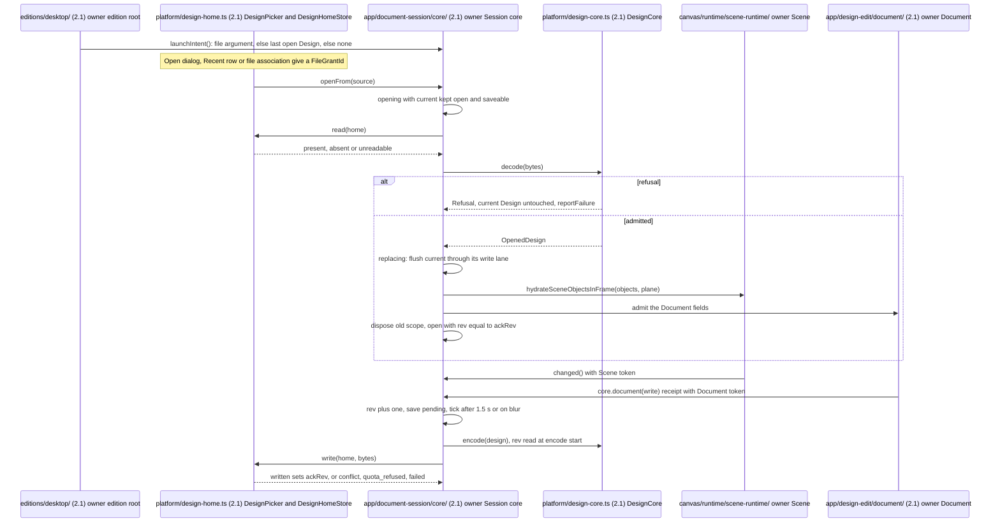
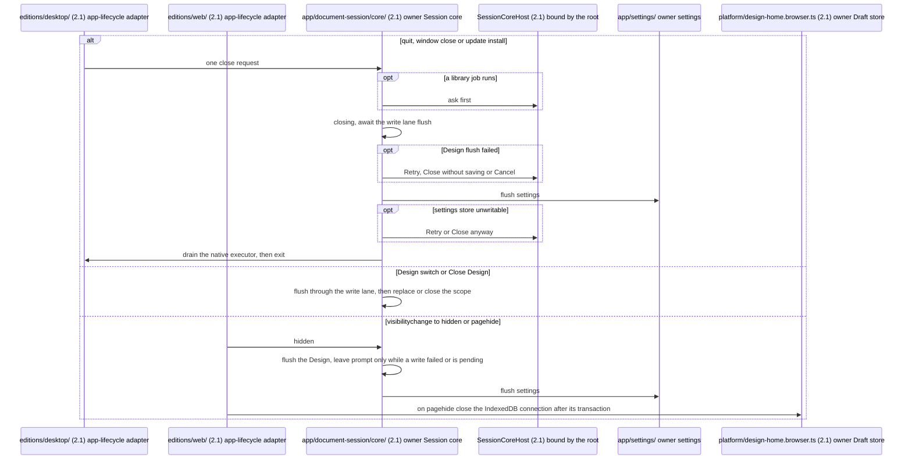
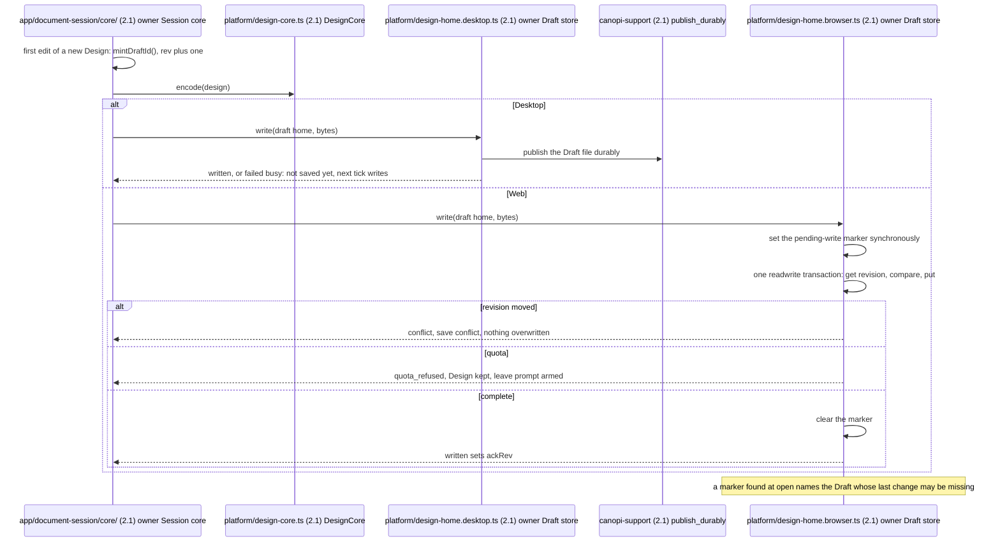
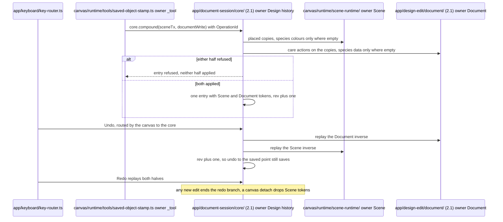
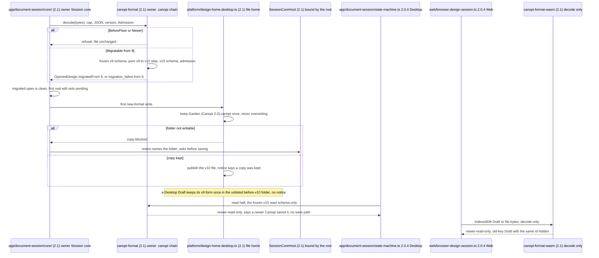
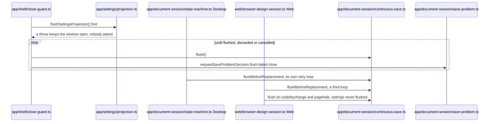

# Design document flows

Answers how a Design is opened, edited, saved, undone, migrated and closed on both editions. Rules: ADR 0009, ADR 0024 (Session core, One Undo order, Close and hide), ADR 0026 (admission, Drafts, Rollback), contracts §4, §10 and §11; the ADR wins on conflict.

### Open, edit and continuous save

Model: target
Source: ADR 0024, contracts §4, 2.1-Q66, 2.1-Q68, 2.1-Q127, 2.1-M85

- Owner: the Session core is the only writer of session state, home, save state and scope; `openFrom` is the one open path, a same-home source answers already-open after a flush.
- Invariant: dirty is `rev > ackRev`; only `written` sets `ackRev`; an edit during a write stays dirty and the lane writes again.
- Tests: contracts §4 scenarios 3, 12, 17 and 18, run against both editions' ports.

### Close and flush

Model: target
Source: ADR 0024 Close and hide, ADR 0009, 2.1-Q20, 2.1-Q22, 2.1-Q61, 2.1-M55

- Owner: close and hide belong to the Session core; adapters never act on page or window events themselves.
- Invariant: the Design flushes before settings; `current` is disposed only after the write that acknowledged its last rev.
- Tests: contracts §4 scenario 4 (a) and (b), scenario 6; the model test of the close machine with a job running.

### Draft persistence

Model: target
Source: ADR 0026 Web Drafts, contracts §11, 2.1-Q22, 2.1-Q40, 2.1-Q47, 2.1-Q82

- Owner: each edition's Draft store adapter; only the core mints a `DraftId` and refuses deleting the open Design's Draft.
- Invariant: every injected fault leaves the last or previous acknowledged revision on reopen; the store takes its `IDBFactory`.
- Tests: the Draft-store suite in Chromium, WebKit and Firefox; contracts §4 scenarios 1, 6, 7, 13 and 16.

### Undo and Redo, with a compound entry

Model: target
Source: ADR 0024 One Undo order, contracts §4, 2.1-Q80, 2.1-M89, 2.1-Q155, 2.1-Q158

- Owner: the Session core holds the one history order; each half is still written by its owner.
- Invariant: one Undo removes the copies and their care actions together; Document writes (views, stories, budget, timeline, consortium, Site data entries, print setup) are entries too.
- Tests: "one Undo restores both halves, one Redo reapplies both"; the Session suite case per Document edit family (2.1-M87).

### v9 to v10 migration and the reader release

Model: target
Source: ADR 0026 `.canopi` admission and Rollback, contracts §10, 2.1-Q35r, 2.1-Q69, 2.1-M21, 2.1-M31, 2.1-M32

- Owner: `canopi-format` owns the chain at the one decode choke point; Web runs it in the core worker and a Web open from bytes makes a Draft with no notice.
- Invariant: a step is pure and frozen; a failing step leaves the file unchanged and lists such a Draft as unreadable; the reader release writes no byte.
- Tests: `migration_steps_frozen`; contracts §4 scenario 12; "reader release: a v10 Design opens read-only and says a newer Canopi saved it".

### Today: two session machines and the close-guard loop

Model: current

- Replaced by the Session core in Phase 2b; deleted with `web/browser-design-session.ts` and the state machine.
