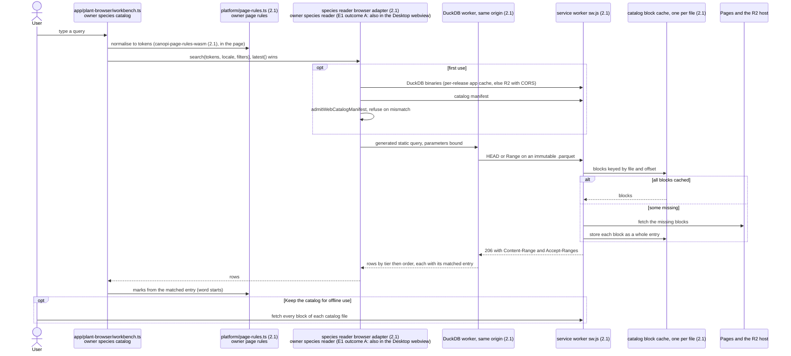

# Flows: outputs and Web delivery

How a Design leaves the app (Canvas PDF, saved stamps) and how Web reads the catalog and survives a deploy. Rules: ADR 0007, ADR 0008, ADR 0024, ADR 0026, ADR 0027 and ADR 0029; the ADR wins on conflict.

### PDF export with per-page angles

Model: target
Source: ADR 0008, ADR 0027; contracts §4, §16, §20; 2.1-Q151, 2.1-Q152, 2.1-M90, 2.1-M91

```mermaid
sequenceDiagram
  actor U as User
  participant ED as components/canvas-pdf/PdfPageEditor.tsx<br/>owner PDF workspace
  participant WF as app/canvas-pdf/workflow.ts<br/>owner PDF workspace
  participant CORE as app/document-session/core/ (2.1)<br/>owner Session core
  participant DE as app/design-edit/<br/>owner Document
  participant QS as canvas/runtime/print-snapshot.ts<br/>owner Scene
  participant GEO as geo/session-plane.ts (2.1)<br/>owner Earth model
  participant JOB as app/canvas-pdf/worker.ts<br/>owner PDF workspace
  participant FD as platform/file-delivery.ts (2.1)<br/>owner edition root
  U->>WF: open the PDF workspace
  WF->>CORE: read print_setup (none: derived default pages, unwritten)
  U->>ED: page angle: North up, As on screen, saved view bearing, Turn to edge, typed
  ED->>WF: page edit (the sheets of a split turn together)
  WF->>DE: write print_setup (2.1)
  DE->>CORE: core.document(write), one entry per workspace session
  WF->>QS: capturePrintSnapshot() (null while an edit owns the Scene)
  WF->>GEO: area centre to plane, groundLength, trueNorthAt(p)
  WF->>JOB: prepare(snapshot, setup, labels)
  Note over JOB: app/canvas-pdf/page-frame.ts turns the snapshot by minus the angle;<br/>app/canvas-pdf/layout.ts lays out level; app/canvas-pdf/encode.ts encodes
  JOB-->>WF: PreparedPdf
  U->>WF: Save (Desktop) or Download (Web)
  WF->>FD: row (bytes, fileStem, kind pdf)
  alt Desktop
    FD->>FD: native dialog, grant, commands/export.rs writes
  else Web
    FD->>FD: Blob download inside the gesture
  end
  FD-->>WF: saved, downloaded or cancelled
```

- Owner: `print_setup` is a Document field written only by Design Edit through `core.document()`; export reads it and the Scene snapshot and never changes Design content, history, dirty state or settings (test: `a reopened Design restores its print setup, and the reader release opens it read-only`).
- Invariant: a page angle is degrees clockwise from true north, read through `trueNorthAt`; only `page-frame.ts` turns, layout modules never take an angle (`page-frame.test.ts`; `a north-up overview and a detail page at 32° each print their north arrow to true north`).
- Every export is one FileDelivery row `(content, stem, kind)` over the one file-kind table; the port alone sanitises the stem (policy `file-delivery-rows`, to be created by 2a).

### Stamp capture and placement

Model: target
Source: ADR 0007, ADR 0024, ADR 0026; contracts §4, §11; 2.1-Q112, 2.1-Q155, 2.1-Q158, 2.1-M88, 2.1-M89

```mermaid
sequenceDiagram
  actor U as User
  participant CS as canvas/runtime/command-surface.ts<br/>owner Scene
  participant WB as app/saved-object-stamps/workbench.ts<br/>owner stamp library
  participant ST as stamp store port (2.1)<br/>owner stamp store
  participant TOOL as canvas/runtime/tools/saved-object-stamp.ts<br/>owner Scene
  participant CORE as app/document-session/core/ (2.1)<br/>owner Session core
  participant TX as canvas/runtime/scene-runtime/transactions.ts<br/>owner Scene
  participant DE as app/design-edit/<br/>owner Document
  Note over U,DE: Capture (Save as stamp; capability row save-as-stamp)
  U->>CS: Save as stamp
  CS->>WB: selection: objects, guides, notes, locks, species appearance
  WB->>DE: read care actions and species planning data of the selection
  WB->>ST: append SavedObjectStampPayload v3 at max + 1
  Note right of ST: Desktop: canopi-store (2.1), user DB payload_json<br/>Web: browser record (2.1)
  Note over U,DE: Placement (one compound entry)
  U->>WB: arm a stamp from Favorites and stamps
  WB->>ST: read row; canopi-format (2.1) chain v2 to v3
  ST-->>WB: payload, or newer: needs a newer Canopi, never placed
  WB->>TOOL: arm with ToolSource saved-stamp
  U->>TOOL: press (pivot: screen-aligned box centre)
  TOOL->>CORE: core.place(fragment, at) (2.1)
  Note right of CORE: species code kept only when free (Q168)
  CORE->>TX: Scene half: copies, selection, fill-only species appearance
  CORE->>DE: Document half: care actions on the copies, fill-only planning data
  alt either half refused
    CORE-->>TOOL: refused, neither half applied
  else both admitted
    CORE-->>U: one entry with both owner tokens; notice names what was added
  end
```

- Owner: each edition's stamp store owns the rows and the library order and runs the payload chain per row at open; `SavedObjectStampPayload` lives in `canopi-types` (2.1), its TS copy in `canvas/saved-object-stamp-payload.ts` is deleted by 2c.
- Invariant: one Undo removes the copies and their care actions together, one Redo reapplies both; fill-only data never overwrites a Design value (test: `a stamp with guides, locks, notes and a care action places them all, and one Undo removes the copies and the action`).
- Deleting a stamp is a library change with its own Undo toast, never a Design history entry (test: `a deleted stamp comes back from its Undo toast`).

### Web catalog reading, caching and search

Model: target
Source: ADR 0027 One ranking contract; ADR 0029 Static Web serving; contracts §15; 2.1-Q113, 2.1-Q116, 2.1-M8, 2.1-M45



- Owner: the build owns keys, display names and order; readers never compute a key or pick a display name; the one generator emits the Web and Desktop queries (corpus suite; `canopi-f47t.52.69: Web plant search matches word starts only, like Desktop`).
- Invariant: the Cache API stores no 206 and matches no Range, so the worker caches whole blocks and assembles 206 itself; without a worker (first visit, disabled) DuckDB reads Pages directly.
- Failures: a failed wasm load reports once and search says it is unavailable; a missing entry table refuses as `plant_db_unavailable{schema_mismatch}`; offline e2e searches the kept catalog with the network off.

### Web deploy, version skew and rollback

Model: target
Source: ADR 0026 Rollback; ADR 0029 Static Web serving; plan Step 2.0.3, W1, D3; 2.1-Q83, 2.1-M25, 2.1-M29, 2.1-M34, 2.1-M36, 2.1-M45

```mermaid
sequenceDiagram
  participant CI as scripts/web_release.py<br/>owner release
  participant PG as Pages host
  participant TAB as open tab of release N
  participant CORE as app/document-session/core/ (2.1)<br/>owner Session core
  participant SWN as sw.js of N (2.1)
  participant SWX as sw.js of N+1 (2.1)
  participant KS as kill-switch sw.js (2.1)
  CI->>CI: verify: N+1 files plus N's verified files, N-2-only dropped
  CI->>CI: refuse a mutable name, a file over 25 MiB, a differing collision
  CI->>PG: deploy merged set
  TAB->>SWN: lazy chunk, catalog read (served from N's caches)
  TAB->>PG: registration.update() on focus, visible or a failed lazy import
  PG-->>SWX: sw.js (no-cache) installs
  SWX->>SWX: fill the N+1 app cache; keep_catalog in IndexedDB canopi-sw (2.1): fetch newly named catalog files
  Note over SWX: the catalog manifest's content name comes from the page bundle
  SWX-->>TAB: waiting: one New version: Reload notice
  TAB->>CORE: Reload: save first (failure offers Download .canopi)
  TAB->>TAB: Reload marks this tab
  TAB->>SWX: skipWaiting
  SWX-->>TAB: controllerchange, only the marked tab reloads into N+1
  Note over SWX: keeps N's cache while an N client remains
  Note over CI,KS: Rollback to the latest stable 2.0.x
  CI->>PG: rollback artifact with kill-switch sw.js, N+1 files kept, N's sw.js left out
  PG-->>KS: installs, skipWaiting at install, takes control
  KS-->>TAB: posts at activate (never a reload): New version: Reload notice
  TAB->>CORE: save first, then reload
  KS->>KS: old tabs from per-release caches (HEAD, Range); new tabs to network
  KS->>KS: last old tab gone: delete app and catalog caches, then unregister
```

- Owner: `web_release.py` owns the merged set and its checks; the service worker owns every cache; the Session core owns the save before any reload (test: `Q83: Reload saves first, and a failed save offers Download .canopi`).
- Invariant: only `index.html`, the edition manifest and `sw.js` are `no-cache`; every other file is immutable, so any kept cache answers any release's tab by URL (deploy-skew e2e: `Q83: a release N-1 tab loads a lazy chunk, reads the catalog and keeps saving after N deploys, then shows one New version: Reload notice`).
- Rollback destroys no work: D3 installs the latest 2.0.x over 2.1.0's stores and finds them read, and no 2.1 cache left once the last 2.1 tab reloads.
