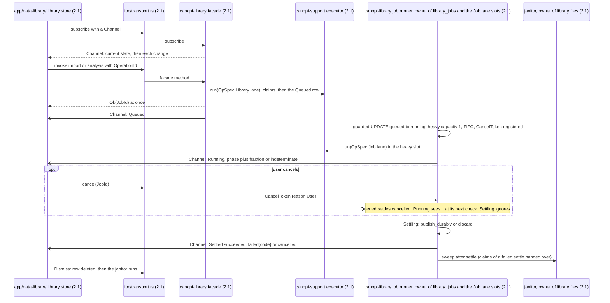
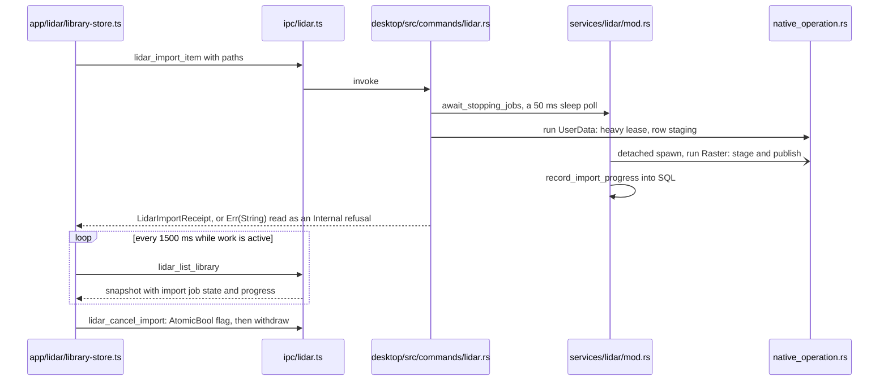
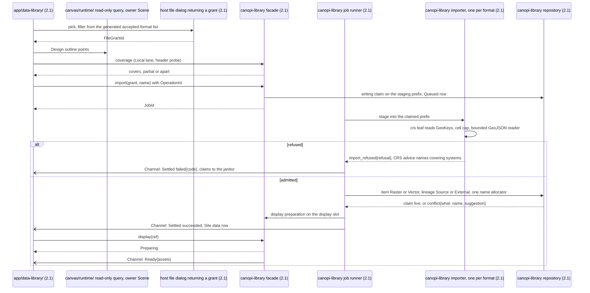
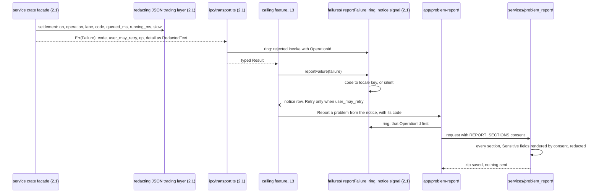
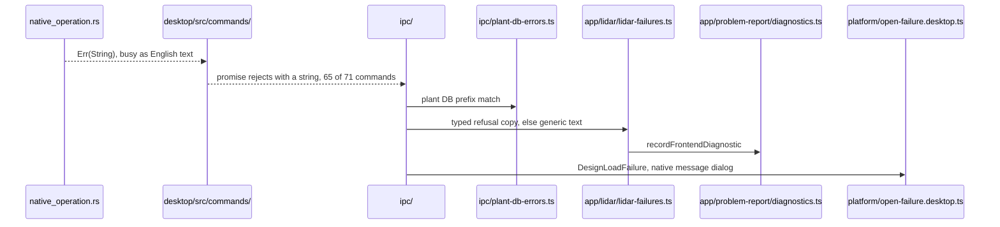

# Service flows

How a job, an analysis, an import, a failure and an update run from the action to the user. The rules are in ADRs 0023, 0024, 0025, 0027, 0029 and 0030 and the foundations contracts §2, §3, §7, §8 and §13; the ADR wins on conflict. Sequence diagrams cannot carry a `classDef`, so only the `(2.1)` marker shows the unbuilt part.

### Job lifecycle with cancel and progress

Model: target
Source: ADR 0024 Library jobs; ADR 0025; contracts §3, §7, §8; 2.1-M56, 2.1-Q38, 2.1-Q61



- Owner: the `jobs.rs` runner is the only writer of `library_jobs`; each transition is a guarded `UPDATE`, 0 rows is `conflict{what: job}`.
- Invariant: state reaches the frontend only through the per-caller Channel (current state, then each change in order); no poll, no broadcast.
- Test: the model-based runner sequence test (contracts §8) and `native_call_contract` case 7.

### Job lifecycle at HEAD (replaced by the runner and the Channel)

Model: current



- Deleted by Phase 3 N1 and N3 (2.1-M56): the poll, the cancel flags, the sleep polls and the `From<String>` refusal.

### Analysis run on Desktop and in the Web worker

Model: target
Source: ADR 0027; ADR 0023 Library internal order; ADR 0030; contracts §2, §7, §8, §13; 2.1-Q65, 2.1-Q122, 2.1-M151

```mermaid
sequenceDiagram
  participant FORM as app/analyses/
  participant DA as platform/library.desktop.ts (2.1)
  participant BA as platform/library.browser.ts (2.1) port relay
  participant F as canopi-library facade and runner (2.1)
  participant ENG as canopi-library terrain engine (2.1)
  participant W as library worker: canopi-library-wasm catalogue and runner (2.1)
  alt Desktop
    FORM->>DA: run(registry row, params, input item)
    DA->>F: job command (job lifecycle above)
    F-->>DA: JobId, or param_invalid{key, code}
    F->>ENG: executor(id) on the heavy slot through blocking::run
    ENG->>ENG: raster input through engines::raster_read from a Read + Seek source
    F->>F: publish item, lineage Analysis, name in the calculation language
    F-)DA: Channel: Settled, then display preparing and ready
  else Web, N5
    FORM->>BA: run(registry row, params, input item)
    BA->>W: submit over the MessagePort
    W->>W: limit check, over it: over_web_limit{limit}; job row in SQLite on OPFS
    W->>ENG: child engine worker, raster_read from an OPFS Read + Seek source
    W->>W: publish item, lineage Analysis; quota full: quota_refused{store: library}
    W-)BA: Settled, or Interrupted at the next open after pagehide or a lost lock
    BA-)FORM: the same state as the Desktop Channel
  end
```

- Owner: the registry row owns params and the display recipe; the quantity table owns display (ADR 0027).
- Invariant: one catalogue, runner and engine on both editions, results are library items only, Refresh exists only for `Analysis` lineage.
- Test: the Data library port suite on both adapters with equal goldens (contracts §13).

### Site data import on Desktop

Model: target
Source: ADR 0027 file-access rule; contracts §1, §7, §8, §9; 2.1-Q99, 2.1-Q100



- Owner: the repository owns item names and SQL; the janitor alone deletes library files.
- Invariant: no command takes a raw path; every writer claims before its first write.
- Test: two imports with one name settle `conflict{what: name, suggestion}`; the claim property test (contracts §9).

### Failure from native code to the notice and the report

Model: target
Source: ADR 0025; contracts §2; 2.1-Q60, 2.1-Q86, 2.1-Q47



- Owner: `failures/` (2.1) owns the sink, the ring and the notice signal; the catalogue in `canopi-types` owns codes.
- Invariant: one request per action, no client retry, no text match on a native error, no native message dialog.
- Test: `every_code_has_a_message_or_is_silent`, `every_code_reaches_the_report`, `ipc/transport.test.ts` (2.1).

### Failure at HEAD (replaced by the typed catalogue)

Model: current



- Deleted by Phase 1 codes and Phase 3 N1 and N2 (2.1-M41): the busy regex in `app/lidar/display.ts`, the prefix matcher and `From<String>`.

### Update per channel and platform

Model: target
Source: ADR 0029 Release safety; ADR 0024 Close and hide; 2.1-Q123, Q136, Q143, Q232 to Q235, M55, M63, M64, M71, M82, M207 to M209

```mermaid
sequenceDiagram
  participant AB as app/updates/ (2.1)
  participant UPD as host/updater/ (2.1)
  participant EP as channel file, stable or beta (2.1)
  participant LC as app-lifecycle port, Desktop adapter (2.1)
  participant CORE as app/document-session/core/ (2.1)
  participant EXE as native executor drain (2.1)
  AB->>UPD: launch check when the key row is on (Q164), or About
  UPD->>EP: fetch the channel the version names, inside the Network lane
  EP-->>UPD: entry os-arch-bundle_type, else os-arch
  UPD->>UPD: refuse a bad signature or a signed version not newer
  AB->>UPD: Download and install (Q235), progress Channel
  UPD-)AB: Channel: download progress, payload capped and verified
  alt Linux AppImage or deb (Q233)
    UPD->>UPD: replace with a backup, or pkexec dpkg -i (Q232); no pkexec: About offers the link
    Note over UPD,AB: a failed install keeps the Design open with Update not installed
  else Windows NSIS or MSI, betas NSIS only
    UPD->>UPD: write the pending-update marker (Q234)
  else macOS dmg
    Note over UPD: self-updates only if the Q136 probe is clean, else waits for a Developer ID
  end
  UPD->>LC: one close request
  LC->>CORE: close requested
  CORE->>AB: a job runs: ask first
  CORE->>CORE: flush Design, then settings, Retry, Close anyway or Cancel
  CORE->>EXE: drain: Shutdown, running job settles Interrupted
  CORE-->>UPD: closed, or cancelled: Linux shows Restart to finish updating, Windows installs nothing
  alt Linux
    UPD->>UPD: release single instance, restart with the Design path (M209)
  else Windows
    UPD->>UPD: launch installer and exit; a failure shows Update not installed at the next launch
  end
```

- Owner: the Rust host owns the updater plugin and the frontend `UpdateState` (`app/updates/` (2.1)); the webview has no `updater:*` permission; the Session core owns the close request. Until 2b the install goes through `app/shell/close-guard.ts`'s `flushBeforeExit`, and until N1 there is no drain (2.1-M63, 2.1-M209).
- Invariant: joining beta is installing a beta, leaving is reinstalling stable; the updater never downgrades.
- Test: `update install during an unsaved edit keeps the edit` and `update install with an unsaveable settings store flushes the Design first, then offers Retry, Close anyway and Cancel` (plan F6), the updater e2e N-1 to N.
