# State machines

Which states each long-lived thing passes through and who moves it. Rules: ADR 0024 (owners and lifecycles), ADR 0025 (failures), ADR 0029 (updater), contracts §4, §6, §8 and §10; the ADR wins on conflict. Mermaid ids replace `-` with `_`; the label keeps the code spelling.

### Design Session

Model: target
Source: ADR 0024, contracts §4, 2.1-Q66
Enum: SessionState (2.1)

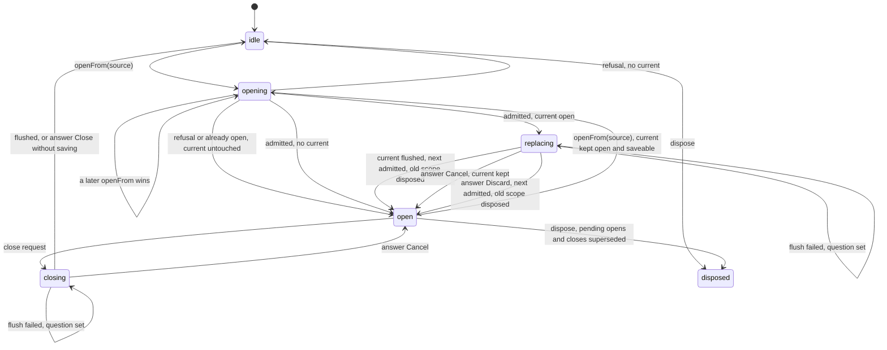

- Owner: the Session core in `app/document-session/core/` (2.1), the only writer of the session, home, save state, scope and question; the dialog renders `question` and calls `core.answer(id, choice)`, a stale id answering `stale` (2.1-M162).
- Dispose starts no write and ignores one in flight; the Desktop adapter destroys the window on the closing-to-idle edge, never on a level.
- Held by the Session suite (contracts §4, cases 3, 4 and 18) and the question model test.

### Save state

Model: target
Source: ADR 0024, ADR 0025, contracts §4, 2.1-Q68, 2.1-Q35r
Enum: SaveState (2.1)

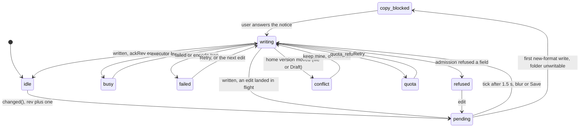

- Dirty is `rev > ackRev`; only `written` sets `ackRev` (2.1-Q68).
- `quota` and `failed` keep the Design in memory and arm the Web leave prompt (contracts §4 case 6).

### Design Session at HEAD (Desktop only)

Model: current
Enum: app/document-session/state-machine.ts::DesignSessionStateStatus

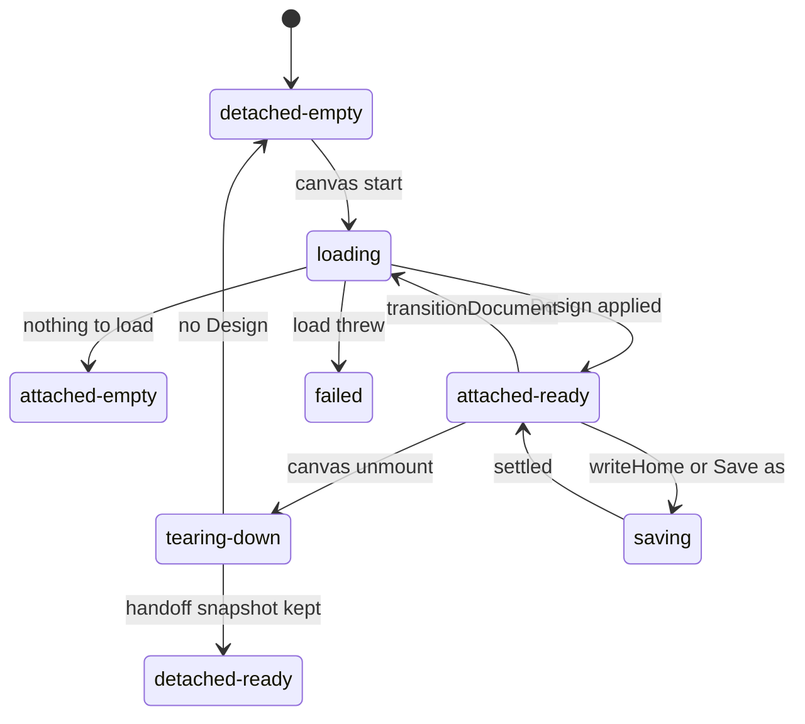

- Web has no state union: `web/browser-design-session.ts` orders work with a `replacementIntent` counter. Both are replaced by the Session core.
- Only tests read `DesignSessionStateStatus`; both editions guard with hand counters (`replacementIntent`, `operationIntent`); 2b deletes both with `DesignSaveStatus`.

### Library jobs

Model: target
Source: contracts §8, ADR 0024 Library jobs, 2.1-Q61, Q38, 2.1-M151
Enum: JobState (2.1)

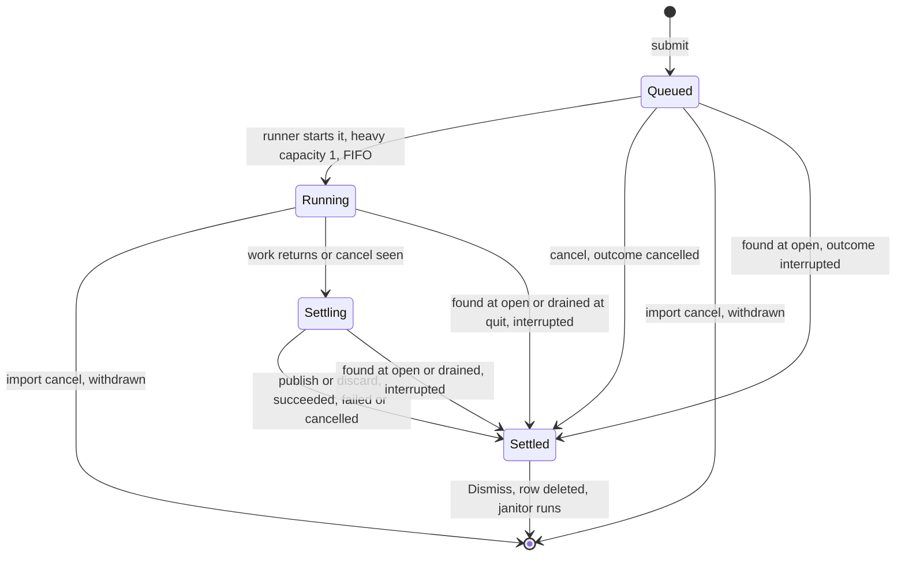

```sql
state TEXT NOT NULL CHECK (state IN ('queued', 'running', 'settling', 'settled')),
outcome TEXT CHECK (outcome IN ('succeeded', 'failed', 'cancelled', 'interrupted')),
CHECK ((state = 'settled') = (outcome IS NOT NULL)),
CHECK ((outcome IS 'failed') = (failure IS NOT NULL))
```

- Owner: the `jobs.rs` runner in `canopi-library` (2.1), on Desktop and in the Web library worker, sole writer of `library_jobs`; each move is a guarded `UPDATE ... WHERE state = ?`, 0 rows is `conflict{what: job}`.
- Settled is final; Retry submits a new job; cancel while Settling is ignored. An import cancel withdraws the row (user 2026-10-09). On Web the page terminates the worker on `pagehide`; the next holder settles in-flight rows Interrupted.
- Held by the jobs model-based test against the real runner and the SQLite CHECK.

### Library jobs at HEAD

Model: current
Enum: common-types/src/lidar.rs::LidarImportJobState

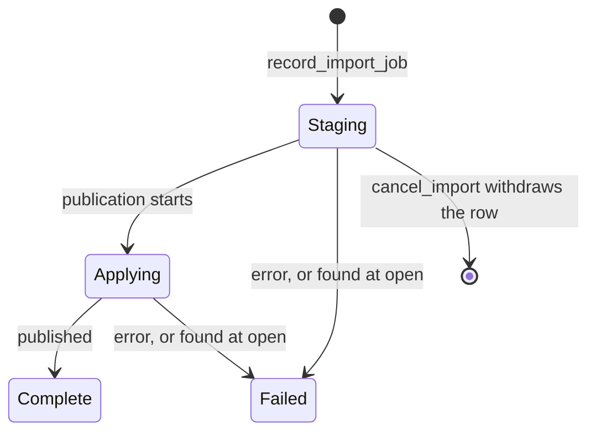

Model: current
Enum: common-types/src/library.rs::AnalysisJobState

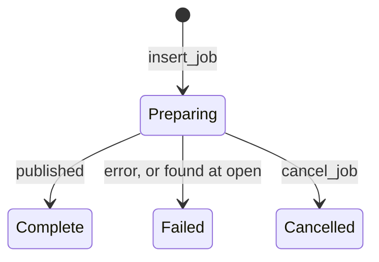

- Two tables, `lidar_import_jobs` and `lidar_analysis_jobs`, with no CHECK on `state`; `services/lidar/analyses/mod.rs` `recover_interrupted_jobs` settles both as failed. Catalogue 26 merges them.

### Updater

Model: target
Source: ADR 0029, ADR 0024, 2.1-M63, 2.1-M64, 2.1-Q233, 2.1-Q234, 2.1-M208, 2.1-Q251, 2.1-Q252
Enum: desktop/web/src/app/updates/state.ts::UpdateState

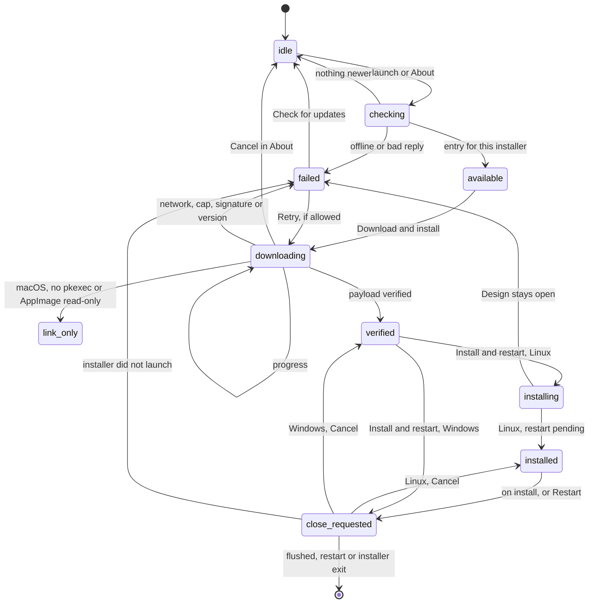

- Owner: `app/updates/` over `host/updater/`.
- Held by the transition-table test, the updater e2e and `an update install while a job runs asks first`.

### Drafts

Model: target
Source: contracts §4 and §11, ADR 0026, 2.1-M21
Enum: HomeRead (2.1)

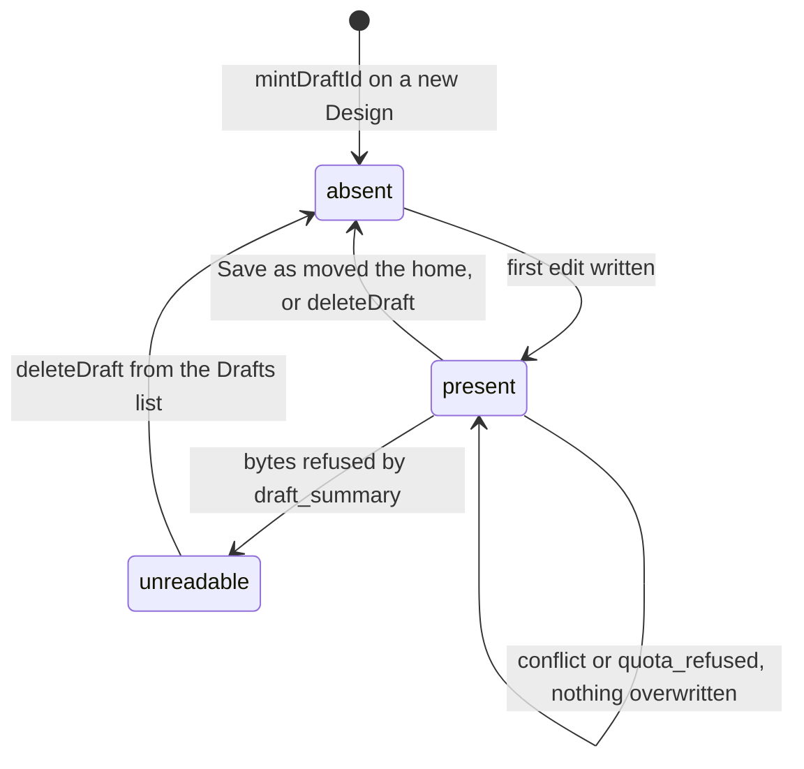

- Owner: one Draft store per edition behind `platform/design-home.ts` (2.1); only the Session core mints ids and writes.
- `deleteDraft` refuses the open Design's Draft on both editions; a Web open from bytes stays absent until an edit.
- Held by the Draft-store suite in Chromium, WebKit and Firefox and scenario cases 1, 2, 12, 13 and 16.

### Tool lifecycle

Model: target
Source: ADR 0024 Tool owner, 2.1-Q41, contracts F29
Enum: ToolHostState (2.1)

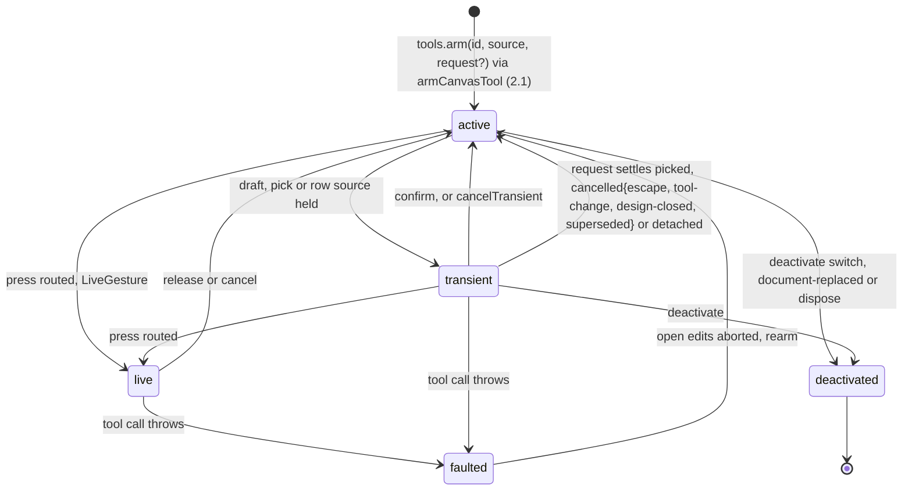

- Owner: `_tool` in `canvas/runtime/interaction-session.ts`; host in `canvas/runtime/tools/tool-host.ts`. A tool picked with no Design open is dropped; each Design starts at its default tool; a tool row a root lacks answers lacking and is never armed (2.1-M163, 2.1-M164).
- Held by `canvas/runtime/tools/tool-host.test.ts` and the ToolHost owner test (2c).

### PDF workspace

Model: target
Source: ADR 0008, 2.1-M90, 2.1-Q151, contracts §10
Enum: app/canvas-pdf/workflow.ts::PdfWorkflowState.status

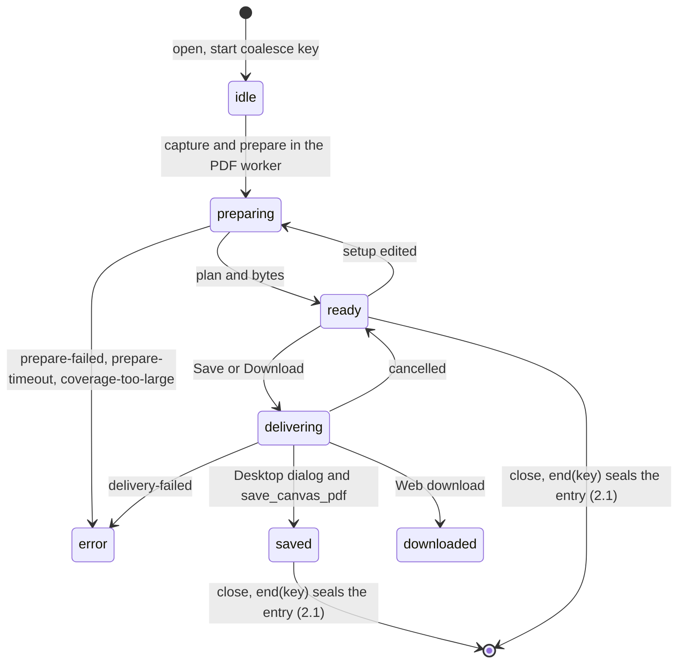

- Owner: `app/canvas-pdf/workflow.ts`; the setup is the Document field `print_setup` (2.1), written by Design Edit under one coalesce key that any other entry seals, the session going on as a new entry (2.1-M160); exporting never changes the Design.

### Map surface lifetime

Model: target
Source: ADR 0024 Canvas surface, ADR 0004, contracts §6
Enum: maplibre/map-lifetime.ts::MapLifetimeState (2.1)

```mermaid
stateDiagram-v2
  [*] --> creating: factory
  creating --> admitted: context and controls settled
  creating --> failed: failed{no-webgl2}, or MapLibre cannot start
  admitted --> ready: style readiness signal
  admitted --> failed: style failed
  ready --> failed: later style.load or context loss
  failed --> creating: Retry
  ready --> released: scene layers, contributions, then the map
  failed --> released
  note right of ready: layers: LayerStatus per slot
```

- Owner: `maplibre/map-lifetime.ts` (2.1), one per map, the snapshot map included. Held by `style-load-only-in-map-lifetime` and the map-lifetime model harness (F4).

### Canvas surface (2.1)

Model: target
Enum: app/canvas-map-surface/canvas-host.ts::CanvasSurfaceState (2.1)

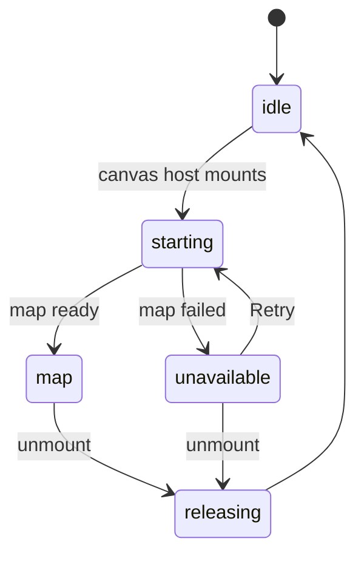

- Computed by `composeSurface(lease, mapState)`; Retry offered only when the map failed, cleanup settled and the runtime alive.

### Map surface at HEAD

Model: current
Enum: maplibre/canvas-surface-state.ts::MapLibreCanvasSurfaceStatus

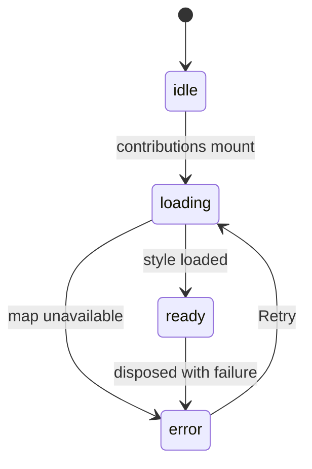

- Published by `app/canvas-map-surface/workspace-map-contributions.ts`, beside `WorkspaceActivationOutcome` and the controls' admission states; the map lifetime absorbs all three.

### Design-core worker

Model: target
Source: contracts §10, ADR 0025 Format core failures, 2.1-M154
Enum: DesignCoreWorkerState (2.1)

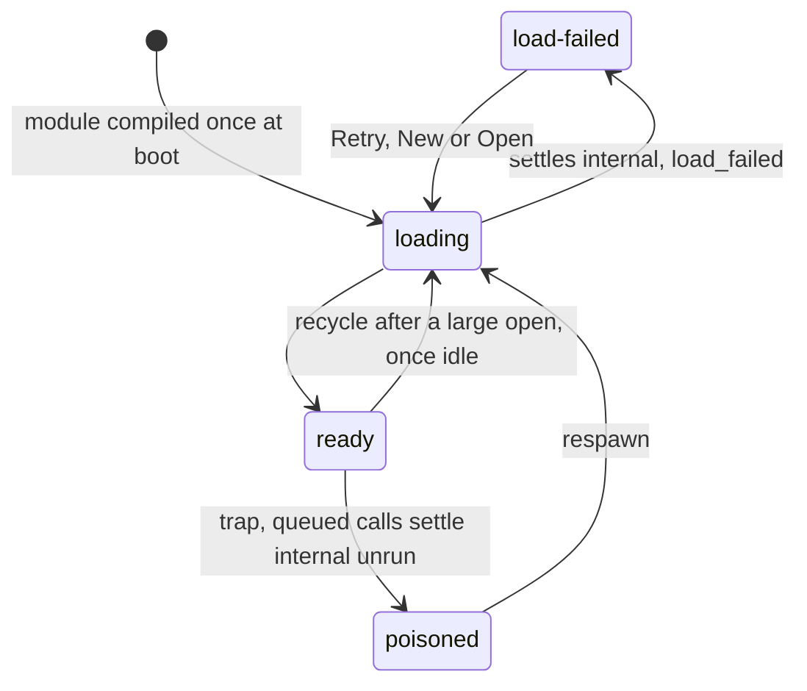

- Owner: `platform/design-core.worker.ts` (2.1) on both editions, the only importer of the `canopi-format-wasm` (2.1) glue; every call settles exactly once and nothing retries silently.

### Web library worker

Model: target
Source: contracts §8, 2.1-M151
Enum: LibraryWorkerState (2.1)

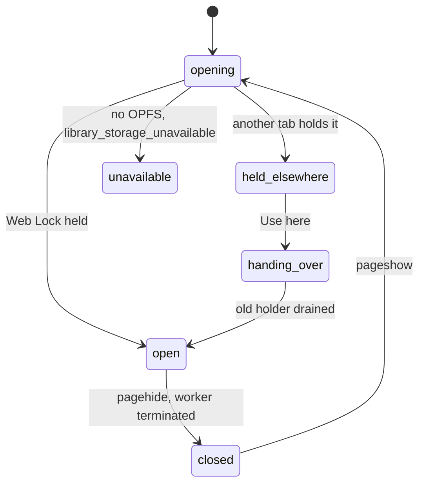

- Owner: the Web library adapter; recovery runs on each open.
